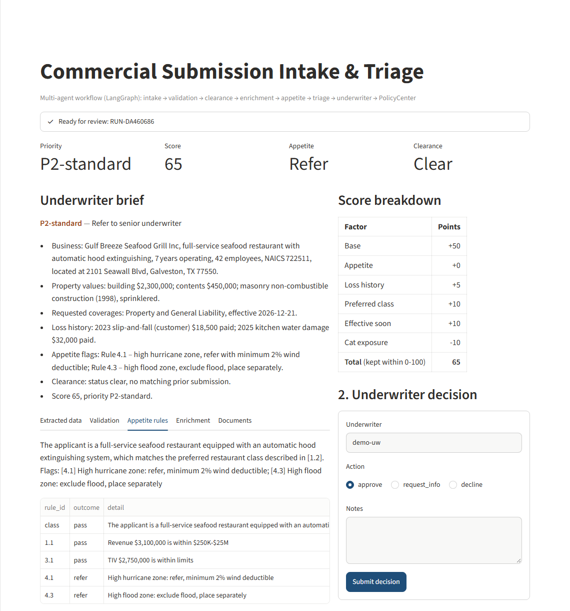
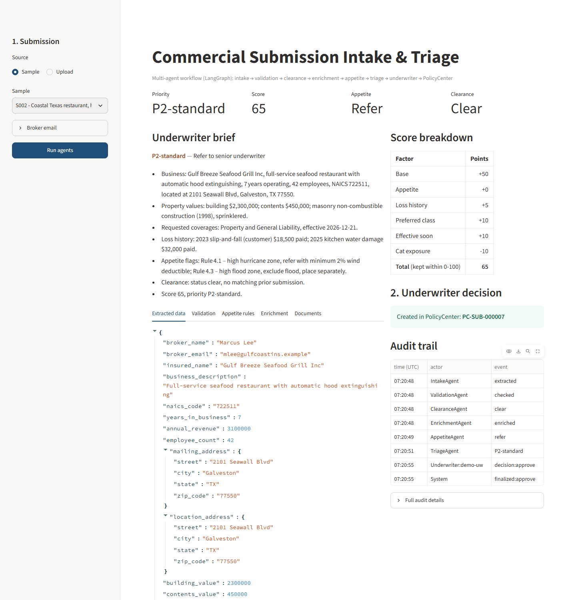
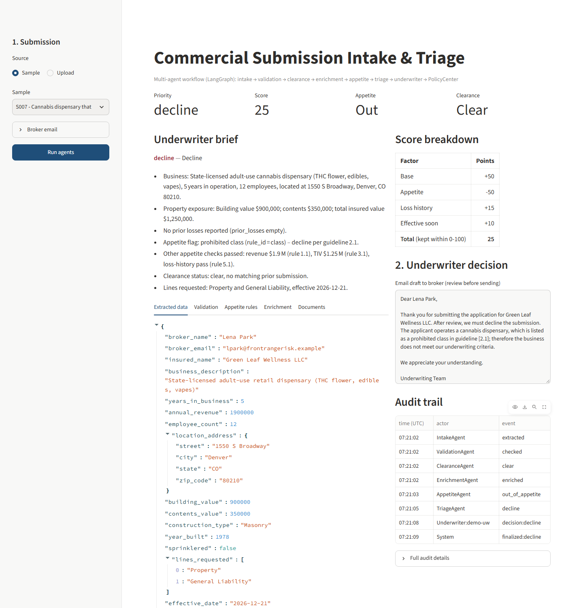
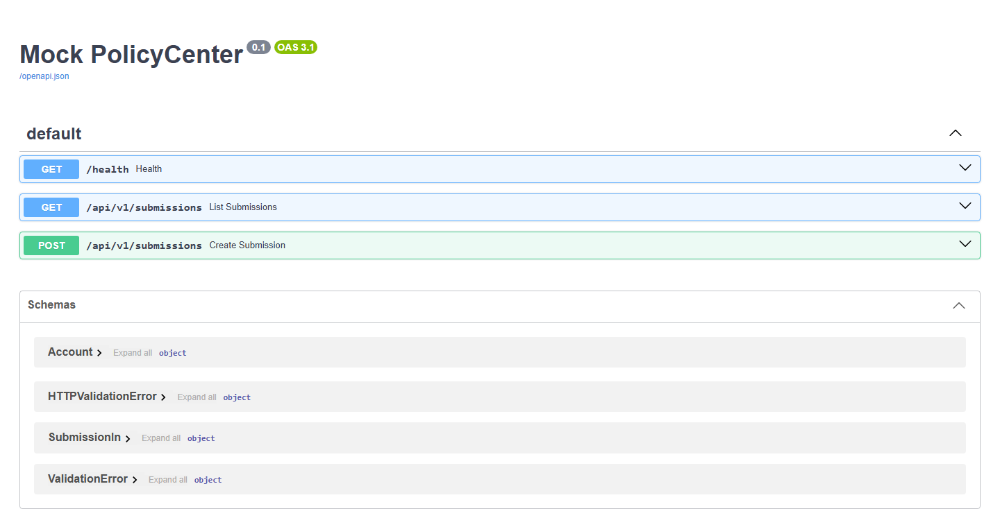
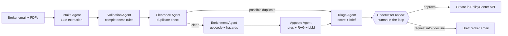

# Commercial Submission Intake & Triage Agent

A multi-agent AI system that reads a broker's submission email and PDFs, checks it against a
carrier's underwriting guidelines, and gives the underwriter a prioritised, explained
recommendation. After the underwriter decides, it creates the submission in a (mock) policy
administration system or drafts the reply to the broker.

Built with **LangGraph**, **Groq** (open-weight LLMs), **Pydantic**, **FastAPI** and **Streamlit**.

**Results on 12 labelled test submissions:** 132/132 fields extracted correctly, 0 invented values,
60/60 decisions correct ([details](#evaluation)).



<details>
<summary><b>More screenshots</b>: approval into PolicyCenter, decline with drafted broker email, the core-system API</summary>

**Approved → created in the policy system, with the full audit trail**


**Declined: a dispensary the model recognised as cannabis (the word never appears), with a drafted email to the broker**


**Mock PolicyCenter REST API (FastAPI)**


</details>

## The problem

Commercial P&C underwriters receive submissions as emails with attached PDFs: ACORD
applications, loss runs, statements of values. Before any underwriting starts, someone has to:

1. Read the documents and retype the data into the core system.
2. Check that nothing is missing, and chase the broker if it is.
3. Check whether another broker already sent the same business (clearance).
4. Decide whether the risk fits the carrier's appetite.
5. Decide which submissions to work on first.

This is slow, manual work. Submissions that sit in an inbox are often lost to a carrier that
replied faster. This project automates steps 1-5 and leaves the decision with the underwriter.

## How it works



| Agent | What it does | LLM or code? |
|---|---|---|
| Intake | Turns email + PDFs into a typed `ExtractedSubmission` (25 fields), decodes form abbreviations, records where email and PDF disagree | LLM, structured output; told to leave unknowns null, never guess |
| Validation | Missing fields, missing loss runs, effective date too soon (guideline §6), email/PDF conflicts | Code |
| Clearance | Fuzzy-matches name + address against prior submissions | Code |
| Enrichment | Geocodes the location (OpenStreetMap), adds catastrophe hazard scores | Tools |
| Appetite | Numeric rules (revenue, insured value, losses, CAT zones) in code; business-class judgment by the LLM using retrieved guideline sections, with citations | Hybrid |
| Triage | Transparent 0-100 score with a per-factor breakdown; LLM writes the one-page brief | Hybrid |
| Human review | LangGraph `interrupt()` pauses the run until an underwriter approves, requests info or declines | Human |
| Finalize | POSTs to the mock PolicyCenter API, or drafts the broker email | Tool + LLM |

### Design choices

- **The LLM only does what needs judgment.** Money arithmetic and thresholds run in code, so
  every decision can be checked and explained. The LLM reads unstructured documents, judges
  business class, and writes text.
- **A human makes every final decision.** The agent recommends; the underwriter decides. Email
  replies are drafts.
- **Everything is auditable.** Every step writes to an append-only SQLite audit log (actor,
  event, detail, timestamp), and appetite decisions cite guideline rule numbers.
- **Built to pause and resume.** State is checkpointed in SQLite, so a run can wait for the
  underwriter and resume later from the CLI or the dashboard.
- **Integration with the core system.** The approved submission goes to a REST API that stands
  in for a policy administration system such as Guidewire PolicyCenter or Duck Creek.

## Demo scenarios

Twelve fictional submissions in `data/submissions/`. The first six cover each path through the
graph; the last six are harder, so the model has to reason rather than copy:

| ID | Scenario | Result |
|---|---|---|
| S001 | Dental office, Austin TX, clean history | **P1-hot**, in appetite, score 100 |
| S002 | Seafood restaurant, Galveston TX | **Refer**: hurricane zone [4.1], flood zone [4.3] |
| S003 | Fireworks manufacturer | **Decline**: prohibited class [2.1] |
| S004 | Warehouse, missing construction, year built, loss runs | **Request info**: broker email drafted |
| S005 | Auto parts store already submitted by another broker | **Clearance hold** (enrichment skipped) |
| S006 | Furniture assembly, 4 claims incl. a fire | **Refer**: [3.2] [5.1] [5.2] [5.3] |
| S007 | "Adult-use dispensary": the word cannabis never appears | **Decline** [2.1]: the LLM recognises the class |
| S008 | Sports bar, liquor ~70% of sales | **Decline** [2.1]: over the 50% alcohol threshold |
| S009 | Email says revenue $3.2M, application says $2.8M; values as "$4.5M", "1.2 million" | **Conflict flagged**, application value used |
| S010 | 2-year-old clinic, $11.5M insured value, unsprinklered | **Refer**: [1.3] [3.1] [3.3] |
| S011 | Abbreviated form ("Insd", "BPP", "Constr.: JM", "Sprk: Y") in wildfire country | **Refer** [4.2], abbreviations decoded |
| S012 | Revenue and staff count only in the email body | Extracted from the email, **P1-hot** |

## Evaluation

Each sample has a hand-written answer key (`expected.json`), written from the documents and
guidelines, not copied from agent output. `scripts/evaluate.py` runs every submission through the
agents and grades the results:

| Metric | Result |
|---|---|
| Field extraction accuracy (11 fields × 12 submissions) | **100%** (132/132) |
| Values invented where the document had none | **0 / 3** |
| Appetite decision correct | 12 / 12 |
| Clearance (duplicate) result correct | 12 / 12 |
| Priority correct | 12 / 12 |
| Missing-information flags correct | 12 / 12 |
| Email/document conflict detected correctly | 12 / 12 |

Model: `openai/gpt-oss-120b` on Groq. Full output: [eval/results.md](eval/results.md).

**What the evaluation caught:** the first run scored 99.2%. On S011 the model copied the form
code "JM" instead of "joisted masonry". The fix was a code-level mapping of standard
construction codes, not a longer prompt, because a fixed list belongs in code.

**Read these numbers with care:** 12 synthetic submissions, written by the same person who wrote
the prompts, is a regression test, not a benchmark. Real broker submissions (scanned forms,
multi-location spreadsheets, long email threads) would score lower. The next step is a larger,
messier set.

## Run it

```bash
# 1. Install (Python 3.11+)
python -m venv .venv
.venv\Scripts\activate            # macOS/Linux: source .venv/bin/activate
pip install -r requirements.txt

# 2. Add your free Groq key (https://console.groq.com/keys)
copy .env.example .env            # macOS/Linux: cp .env.example .env

# 3. Generate the sample submissions
python scripts/generate_samples.py

# 4a. Underwriter dashboard (the mock PolicyCenter API runs inside the app by default)
streamlit run ui/streamlit_app.py

# 4b. ...or the command line
python run_cli.py S001
python run_cli.py S003 --auto decline

# Optional: run the mock PolicyCenter as a separate service (real network calls)
uvicorn mock_policycenter.api:app --port 8001     # then set POLICYCENTER_URL=http://127.0.0.1:8001

# Tests for the rule-based parts (no API key needed)
pip install -r requirements-dev.txt
pytest -q

# Accuracy evaluation against the answer key (uses the LLM, ~4 min on the free tier)
python scripts/evaluate.py
```

## Deployment

Hosted for free on **Streamlit Community Cloud** (main file `ui/streamlit_app.py`, Python 3.12).
The Groq key is stored in the platform's secret settings, not in the code. For a public demo:

- The mock PolicyCenter runs in-process (`POLICYCENTER_URL=embedded`): one service, still a real
  HTTP request through FastAPI routing and validation.
- Each visitor session is limited to 10 runs (`MAX_RUNS_PER_SESSION`) to protect the free LLM quota;
  uploads are capped at 5 MB.
- Sample submissions are regenerated at startup so effective dates stay relative to today.

## Project layout

```
app/
  agents/        intake, validation, clearance, enrichment, appetite, triage, communications
  graph.py       LangGraph workflow, routing, human-in-the-loop, checkpointing
  schemas.py     Pydantic models for every agent's output
  rag.py         BM25 retrieval over numbered guideline rules
  tools.py       geocoding (OpenStreetMap) + hazard lookup
  audit.py       append-only audit log
data/
  guidelines/    fictional carrier underwriting guidelines (the RAG source)
  submissions/   generated sample submissions
mock_policycenter/  FastAPI stand-in for the policy admin system
ui/              Streamlit underwriter dashboard
scripts/         sample generator, evaluation, screenshot capture (Playwright)
docs/screenshots/
tests/           unit tests for the deterministic logic
```

## Limitations and next steps

- Hazard data is mocked by state/city. Next: a real flood-zone and wildfire-score API.
- Sample PDFs are generated, text-based ACORD-style forms. Real submissions include scanned
  forms (needs OCR) and Excel statements of values with many locations.
- The mock PolicyCenter is not the Guidewire Cloud API; it shows the integration pattern only.
- Free-tier Groq throttles requests: one submission takes ~4s alone but ~20s in a batch run.
  A paid tier or a queue would fix this.
- Next: a broker-email inbox connector instead of folders, and a larger, messier evaluation set.

All companies, people and the carrier in this project are fictional.
